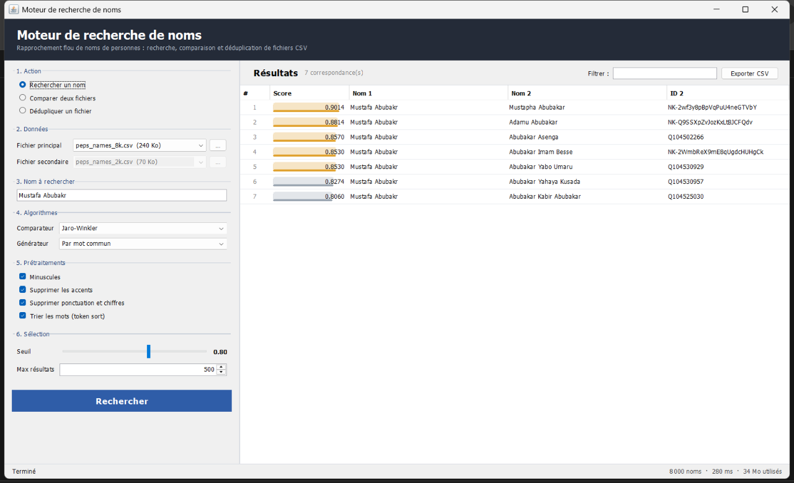
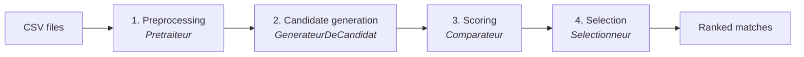

# Moteur de Recherche — Fuzzy Name Matching Engine


A configurable **record-linkage engine** for person names, written in pure Java (no external libraries).
It finds names that refer to the same person despite typos, different word order, accents or punctuation:

| Query             | Match found           | Score |
|-------------------|-----------------------|-------|
| `Mustafa Abubakr` | `Mustapha Abubakar`   | 0.90  |
| `helene dupont`   | `Hélène Dupont`       | 1.00  |
| `Dawid Boois`     | `Boois, Dawid`        | 1.00  |

It supports three operations on CSV files of up to **658,000 names**:

- 🔎 **Search**: find one name in a dataset
- 🔗 **Compare**: link the names of dataset A to dataset B
- 🧹 **Deduplicate**: find duplicates inside one dataset

Both a **desktop GUI** and an **interactive CLI** are provided.



---

## Table of contents

- [Quick start](#quick-start)
- [How it works](#how-it-works)
- [Project structure](#project-structure)
- [Usage](#usage)
- [CSV format](#csv-format)
- [Performance](#performance)
- [Tests](#tests)
- [Roadmap](#roadmap)

---

## Quick start

**Requirement:** JDK 17 or newer (`java -version`).

```bash
git clone https://github.com/yahyahouimdi/search-engine.git
cd search-engine
```

| Command (Windows)  | Command (macOS / Linux / Git Bash) | What it does                     |
|--------------------|------------------------------------|----------------------------------|
| `run.bat`          | `./run.sh`                         | Compile and open the GUI         |
| `run.bat cli`      | `./run.sh cli`                     | Compile and start the CLI        |
| `run.bat test`     | `./run.sh test`                    | Compile and run the test suite   |
| `run.bat jar`      | `./run.sh jar`                     | Build `build/moteur-de-recherche.jar` |

<details>
<summary>Without the scripts (plain <code>javac</code>)</summary>

```bash
mkdir -p build/classes
javac -encoding UTF-8 -d build/classes $(find src/main/java -name "*.java")
java -cp build/classes moteur.ui.InterfaceRecherche     # GUI
java -cp build/classes moteur.cli.Main                  # CLI
```

</details>

---

## How it works

Every operation runs the same four-stage pipeline. Each stage is an **interface** (strategy pattern),
so an implementation can be swapped without touching the engine:



| Stage | Purpose | Implementations |
|-------|---------|-----------------|
| **Preprocessing** | Normalize names before comparing them | Lower case · Remove accents (`é → e`) · Remove punctuation & digits · Sort words (`Boois Dawid` = `Dawid Boois`) |
| **Candidate generation** (blocking) | Avoid comparing every name with every other one (658k² ≈ 433 billion pairs) | **By shared word prefix**: inverted index on the first 3 letters of each word · **By length**: only names whose lengths are within 20% |
| **Scoring** | Similarity between 0 and 1 | **Jaro-Winkler** (good for short strings and typos, rewards common prefixes) · **Levenshtein** (`1 - edit distance / max length`) · **Exact equality** |
| **Selection** | Keep the relevant pairs, best first | **Threshold** (score ≥ s) · **Top N** · **All** |

Large inputs are processed **in blocks** to bound memory. In deduplication mode, self-matches and mirrored pairs (`A↔B` / `B↔A`) are removed.

---

## Project structure

```
.
├── data/                     # Sample datasets: peps_names_800.csv … peps_names_658k.csv
├── docs/interface.png        # GUI screenshot used in this README
├── src/main/java/moteur/     # Application sources (34 classes, 10 packages)
├── src/test/java/moteur/     # Test suite
├── run.bat / run.sh          # Build & run scripts (gui | cli | test | jar)
├── .gitattributes            # Line endings (CRLF for .bat, LF for the rest)
└── README.md
```

The `moteur` packages map one-to-one onto the pipeline stages, plus the two front ends:

| Package | Class | Role |
|---------|-------|------|
| `moteur` | `MoteurDeRecherche` | Runs the pipeline: `rechercher`, `comparer`, `dedupliquer`; processes large inputs in blocks |
| | `Configuration` | Holds the four strategies; `parDefaut()` gives the recommended setup |
| `moteur.modele` | `Nom` | One record: ID, normalized name, original name (shown in results) |
| | `CoupleDeString` | Raw CSV row (`id`, `name`) |
| | `CoupleDeNom` | A candidate pair of names to compare |
| | `NomAvecScore` | A pair with its similarity score |
| | `ListeDesNoms` / `ListePretraiter` / `ListeGeneree` | Data between stages: raw rows → normalized names → candidate pairs |
| `moteur.recuperation` | `Recuperateur` | Interface: data source |
| | `RecuperateurFichierCsv` | UTF-8 CSV reader with quoted-field support |
| | `Datasets` | Finds CSV files in `data/` and resolves file names |
| `moteur.pretraitement` | `Pretraiteur` | Interface: `String → String` normalization step |
| | `PretraiteurToLowerCase` | `Houda AMER` → `houda amer` |
| | `PretraiteurSansAccents` | `Hélène` → `Helene` |
| | `PretraiteurSansCaracteresNiChiffres` | `Boois, Dawid (2)` → `Boois Dawid` |
| | `PretraiteurAvecTokenisation` | Sorts words: `dawid boois` → `boois dawid` |
| `moteur.generation` | `GenerateurDeCandidat` | Interface: picks which pairs are worth comparing |
| | `GenerateurParToken` | Pairs names sharing a word prefix (first 3 letters) |
| | `GenerateurParTaille` | Pairs names whose lengths are within 20% |
| `moteur.comparaison` | `ComparateurDeChaine` | Interface: string similarity in [0, 1] |
| | `ComparateurAvecJaroWinkler` | Jaro-Winkler similarity |
| | `ComparateurAvecLevenshtein` | `1 - edit distance / max length` |
| | `Comparateur` | Interface: name similarity in [0, 1] |
| | `ComparateurDeNomParChaine` | Adapts any `ComparateurDeChaine` to names |
| | `ComparateurSimple` | Exact equality (1 or 0) |
| `moteur.selection` | `Selectionneur` | Interface: filters and ranks scored pairs |
| | `SelectionneurParSeuil` | Keeps scores ≥ threshold |
| | `SelectionneurDesNmeilleurs` | Keeps the N best |
| | `SelectionneurTout` | Keeps everything, sorted |
| | `ComparateurDeScore` | Orders by descending score |
| `moteur.util` | `AnalyseMemoire` | Memory usage statistics |
| `moteur.cli` | `Main` | Interactive command-line menu |
| `moteur.ui` | `InterfaceRecherche` | Swing desktop interface |
| *(tests)* | `TestsMoteur` | 14 dependency-free tests (algorithms, preprocessing, CSV, end-to-end) |

---

## Usage

### Desktop GUI

1. Choose an **action**: search, compare or deduplicate.
2. Choose the **dataset(s)**. Files in `data/` are listed automatically; use **…** to open any other CSV.
3. For a search, type the **name**, then press <kbd>Enter</kbd>.
4. Optionally adjust the **comparator**, **generator**, **preprocessing** and **threshold**.

Results can be **sorted** by any column, **filtered** live, and **exported to CSV**.
The status bar shows dataset size, execution time and memory used. Loaded datasets are cached, so later runs are faster.

### CLI

```
==================================================
            MOTEUR DE RECHERCHE DE NOMS
==================================================
  Fichier principal  : peps_names_8k.csv
  Fichier secondaire : peps_names_2k.csv
  Comparateur        : Jaro-Winkler (seuil 0.80)
  ...
  1. Rechercher un nom dans le fichier principal
  2. Comparer le fichier principal au fichier secondaire
  3. Dédupliquer le fichier principal
  4. Configurer la recherche
  5. Changer de fichiers
  0. Quitter
```

The datasets can also be passed as arguments: `run.bat cli peps_names_658k.csv peps_names_32k.csv`.

### As a library

```java
MoteurDeRecherche moteur = new MoteurDeRecherche(Configuration.parDefaut());

ListeDesNoms reference = new ListeDesNoms(new RecuperateurFichierCsv("peps_names_8k.csv").recuperer());
ListeDesNoms requete   = new ListeDesNoms(List.of(new CoupleDeString("Q1", "Mustafa Abubakr")));

for (NomAvecScore r : moteur.rechercher(requete, reference)) {
    System.out.println(r.getScore() + "  " + r.getCouple().getNom2().getNomOriginal());
}
```

---

## CSV format

UTF-8, two columns, with a header line:

```csv
id,name
NK-2wf3y8pBpVqPuU4neGTVbY,Mustapha Abubakar
NK-Lk3jsaKE9r5KNq5dwXoVUw,"Boois, Dawid"
```

Quoted fields may contain commas. Incomplete lines are skipped.

---

## Performance

Measured on a laptop (JDK 17, Jaro-Winkler, default preprocessing, prefix generator):

| Operation | Dataset | Time |
|-----------|---------|------|
| Search one name | 8,000 names | ~0.3 s |
| Search one name | 658,000 names | ~3.6 s (including loading the 31 MB file) |
| Deduplicate | 8,000 names | ~1.2 s |

For big comparisons or deduplications, give the JVM more memory, for example
`java -Xmx4g -cp build/classes moteur.ui.InterfaceRecherche`.

---

## Tests

```bash
./run.sh test        # or run.bat test
```

Covers the reference values of Jaro-Winkler (`MARTHA/MARHTA = 0.961`) and Levenshtein (`kitten/sitting = 3`),
every preprocessor, CSV parsing with quoted commas, and end-to-end search, comparison and deduplication.

---

## Roadmap

- [ ] Phonetic preprocessing (Soundex / Metaphone)
- [ ] Parallel scoring of candidate pairs
- [ ] Maven / Gradle build and JUnit
- [ ] Configurable CSV columns and separator

## Author

**Yahya Houimdi** — [github.com/yahyahouimdi](https://github.com/yahyahouimdi)
